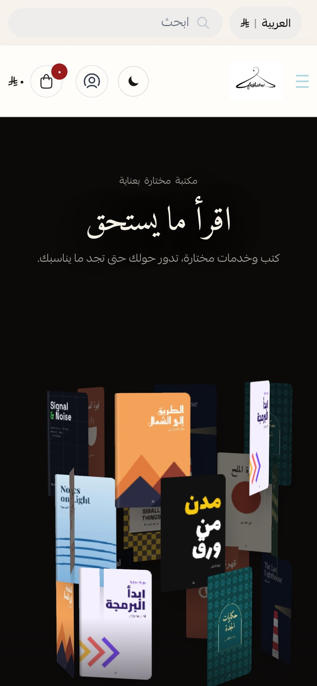
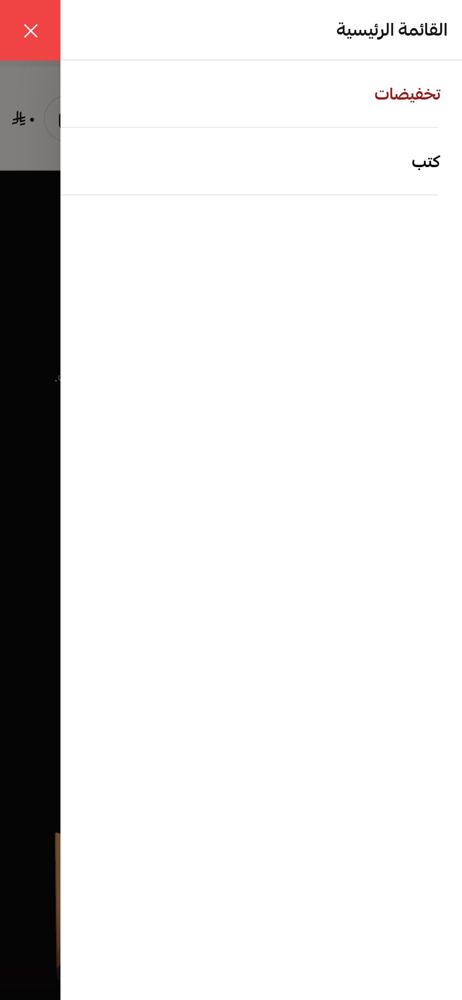
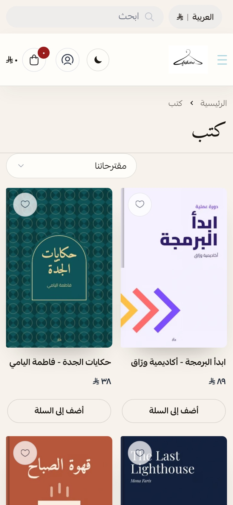
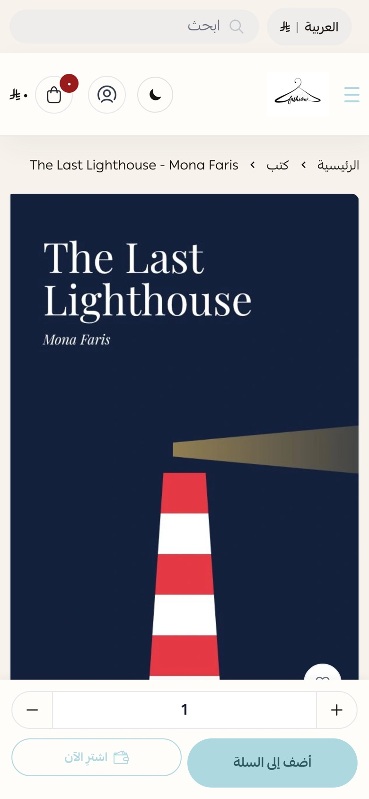
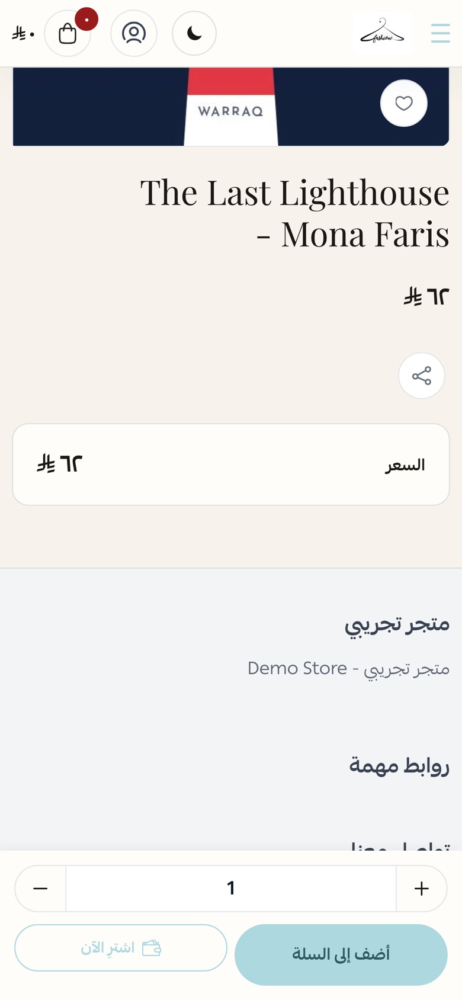

# Warraq | ورّاق

A Salla theme for book, services and tech stores: warm paper tones, serif headings, product cards shaped like book covers, and a 3D swirl of floating cards on the home page.

**[دليل الإعداد | Setup guide](GUIDE.md)**

### On phones | على الجوال

  
  
  
  
  

## Support | الدعم

Questions, problems or customisation requests: **surelyshahad@gmail.com**

للأسئلة أو المشاكل أو طلبات التخصيص: **surelyshahad@gmail.com**

---

This repository holds the setup guide and screenshots of the theme (`screenshots/`, phone views in `screenshots/phone/`). The theme code itself is private.
